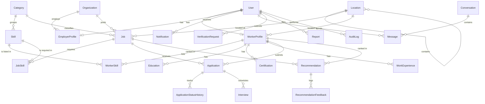

# ETHIOTALENT AI: Architecture and Development Plan

*Connecting Ethiopian Talent with the Right Opportunities.*

Status: Phase 1 (requirements and architecture). No application code yet.

---

## 0. Scope strategy (read first)

The brief lists 20 deliverables. For a final-year defense the thing that must work end to end is the **core demo**:

1. Worker registers, builds a profile.
2. Employer registers, publishes a job.
3. AI extracts requirements from the job text (employer reviews and approves).
4. AI ranks suitable workers.
5. Each score is computed and explained (per-component breakdown).
6. Employer views, compares and shortlists.
7. Worker sees recommended jobs and applies.

Everything is tiered around that:

| Tier | Meaning | Items |
|---|---|---|
| **P0 core** | Must work for the defense | Auth/RBAC, profiles, jobs, skills taxonomy, applications, hybrid matching engine with explanations, JD analysis, employer/worker dashboards, evaluation harness |
| **P1** | Strong value, build after P0 | CV (PDF) analysis, notifications + messaging (Socket.IO), admin dashboard, verification workflow, reporting/moderation, Leaflet maps, Amharic/Afaan Oromo UI |
| **P2** | Architected, minimal or stubbed, clearly labeled | SMS provider, training institutions module, AI career/recruiter assistant, national analytics, learning-to-rank |

Rule from the brief that we keep: anything not implemented is labeled "not implemented" in the UI and docs, never faked.

---

## 1. Requirements

### 1.1 Functional requirements (by module)

**FR-AUTH**: register by phone (primary) or email; bcrypt/Argon2 hashing; JWT access + refresh; roles WORKER, EMPLOYER, ADMIN, TRAINER; phone OTP and email verification (provider-configured, dev mode logs OTP); password reset.

**FR-WORKER**: profile (headline, bio, occupation, category, skills with proficiency, experience, education, certifications, work history, portfolio, languages, expected salary, employment-type preference, availability, preferred locations, optional CV, optional GPS). Each qualification/skill carries `source = SELF_REPORTED | VERIFIED`. Profile completion %. No certificate required.

**FR-EMPLOYER**: organization profile, type, verification documents, status `UNVERIFIED | PENDING | VERIFIED | REJECTED`. Worker search with filters (skills, experience, location, availability, qualification), compare, shortlist, contact.

**FR-JOB**: full job form (all fields in brief), 8 employment types, work mode (on-site/remote/hybrid), deadline, vacancies, status lifecycle `DRAFT, PENDING_REVIEW, ACTIVE, CLOSED, FILLED, REMOVED`, duplicate detection.

**FR-APPLY**: statuses PENDING, UNDER_REVIEW, SHORTLISTED, INTERVIEW_SCHEDULED, ACCEPTED, REJECTED, WITHDRAWN; state-machine enforced; status history; interview scheduling; save jobs.

**FR-MATCH**: job→workers and worker→jobs ranking; per-component sub-scores; explanation text generated from the same numbers; admin-configurable weights (global + per category); recommendation records persisted for evaluation.

**FR-AI**: JD extraction (skills, experience, qualification, category, type) with approval step; CV extraction with review/correct step; skill-gap recommendations; assistants (P2).

**FR-COMM**: conversations + messages, real-time via Socket.IO, notification center, optional SMS adapter.

**FR-TRUST**: reports (job/account), moderation queue, verification requests, audit log, employer verification badge only when an admin approves evidence.

**FR-ADMIN**: user management/suspension, verification queue, categories and skills taxonomy, translation management, matching weights, reports, system activity, AI performance review.

**FR-ANALYTICS**: per-role dashboards; national stats are aggregates only, with minimum cell size (k ≥ 5) suppression.

**FR-I18N**: English, Amharic, Afaan Oromo UI strings stored as translation files plus admin-editable overrides.

### 1.2 Non-functional requirements

| Area | Requirement |
|---|---|
| Security | OWASP Top 10 coverage; parameterized queries (Prisma); Zod validation on every endpoint; helmet, CORS allow-list, rate limiting; upload type sniffing by magic bytes + size cap + random filenames outside web root; CSRF protection for cookie-based refresh flow (SameSite + double submit); secrets only via env |
| Privacy | Data minimization; GPS coordinates stored but only a coarse (~1 km rounded) location exposed to employers, exact never; phone/email hidden until application or worker consent |
| Performance | Match top-50 for a job in < 2 s for 10k workers (target); embeddings precomputed and cached, not computed per request |
| Availability | Stateless API behind Nginx; Docker Compose; DB backups (pg_dump cron) |
| Accessibility | WCAG AA contrast, keyboard navigation, light + dark mode, low-bandwidth friendly (small bundles, lazy routes) |
| Mobile | Mobile-first responsive layouts; most Ethiopian users are on phones |
| Maintainability | TypeScript strict, modular folders, shared Zod schemas, lint + format, CI |
| Observability | Structured logging (pino), request IDs, health endpoints |

---

## 2. System architecture

```
 Browser (React + TS + Tailwind)
        |  HTTPS / REST + WebSocket
        v
      Nginx (TLS, static files, reverse proxy)
        |
        v
 Node/Express API (TypeScript)  ------ Socket.IO (same process, Redis adapter later)
   modules: auth, users, workers, employers, jobs,
            applications, matching (orchestrator), notifications,
            messaging, trust, admin, analytics, i18n
        |                         \
        | Prisma                   \  HTTP (internal network only, service token)
        v                           v
 PostgreSQL (+PostGIS)         Python AI service (FastAPI)
 uploads volume                  /extract/job   /extract/cv
                                 /embed         /match/job-to-workers
                                 /match/worker-to-jobs   /explain
                                 /skills/recommend       /health
```

Key decisions:

- **Matching ownership.** The Express API owns data and authorization. It sends the AI service only the minimal, de-identified feature payload (skill IDs, years, coordinates for distance, etc.), never names or phone numbers. The AI service is stateless apart from an embedding cache, so it can be scaled and tested independently.
- **Embeddings.** Stored in Postgres (`pgvector` extension, or `float4[]` for a simple start) keyed by entity + model version, computed on profile/job create/update through a queue, not on request. This gives sub-second ranking.
- **Graceful degradation.** If the AI service is down, the API falls back to the rule-based matcher (deterministic, in TypeScript) and flags `engine: "rule-based-fallback"` in the response.
- **Contracts.** OpenAPI for the public API (generated from Zod); a separate OpenAPI spec for the AI service (FastAPI generates it). Versioned: `/api/v1`, `/ai/v1`.
- **Real time.** Socket.IO rooms per user; JWT checked on handshake; events: `notification:new`, `message:new`, `application:status`.

---

## 3. Matching engine design (the core)

### 3.1 Score

For a (job, worker) pair, each component yields `s_i ∈ [0,1]` or `null` (missing). Final score:

```
score = 100 * Σ(w_i * s_i over known i) / Σ(w_i over known i)      # weights renormalized
confidence = Σ(w_i over known i) / Σ(w_i)                          # shown to the user
```

Missing data is excluded and the remaining weights renormalized, so a worker is not punished with a zero for a field they never had a chance to fill, but low `confidence` is displayed rather than hidden.

Default weights (admin-editable, per-category overrides):

| Component | Weight | How computed |
|---|---|---|
| Skills | 0.35 | Blend of (a) weighted exact/related skill coverage using the skill taxonomy graph (exact = 1.0, sibling/related = 0.5–0.7, transferable = 0.3–0.4, proficiency-scaled) and (b) semantic cosine similarity of job text vs worker profile text |
| Experience | 0.20 | Relevant years (years in same/related category) vs requirement; if the employer set no minimum, inexperience is **not** penalized (component = null or 1.0 for "entry OK") |
| Location | 0.15 | Haversine distance if both coordinates; otherwise administrative hierarchy match (woreda > zone > region); remote jobs → 1.0; relocation willingness bumps cross-region |
| Qualification | 0.10 | If job requires none → null. Otherwise degree/certificate level and field relevance; **practical-skill equivalence** can substitute (verified skills count more) |
| Availability | 0.10 | Worker availability window/type vs job start, schedule and deadline |
| Salary and preferences | 0.10 | Range overlap (expected vs offered), employment-type and work-mode preference |

### 3.2 Explainability

The explanation is built from the component values, never written independently of them. Example output:

```json
{
  "score": 82.4, "confidence": 0.9,
  "components": {"skills": 0.88, "experience": 0.75, "location": 1.0, ...},
  "matchedSkills": ["Engine diagnostics", "Brake systems"],
  "relatedSkills": [{"required": "Auto electrical", "has": "Electrical wiring", "credit": 0.6}],
  "missingSkills": ["OBD-II scanning"],
  "text": "Strong match: 4 of 5 required skills (1 via a related skill), 3 years of relevant experience, and 4.2 km from the job site."
}
```

### 3.3 Semantic layer

- Model: `paraphrase-multilingual-MiniLM-L12-v2` (or `multilingual-e5-small`) via Sentence Transformers; Amharic coverage is partial and Afaan Oromo coverage is weak, so **we measure it, not assume it** (see 6). Mitigation: a bilingual skill-label table (EN/AM/OM) in the taxonomy so skills match by ID across languages even where embeddings are weak.
- Skill normalization: free-text skill → nearest taxonomy skill by embedding + alias table, with a similarity threshold; unmatched skills are kept as free text and queued for admin taxonomy review.

### 3.4 Learning (honest scope)

Phase 1 ships fixed, configurable weights. The data model logs impressions, applications, shortlists, hires and feedback so a later learning-to-rank step (e.g., logistic regression or LightGBM on these signals) is possible. It will be described as "future work" unless it is actually trained and evaluated.

---

## 4. Database design

### 4.1 Entities (Prisma / PostgreSQL)

```
User(id, phone UNIQUE, email UNIQUE NULL, passwordHash, role, status,
     phoneVerifiedAt, emailVerifiedAt, locale, createdAt, ...)
Location(id, level[REGION|ZONE|WOREDA|KEBELE], name_en, name_am, name_om, parentId→Location, lat, lng)
WorkerProfile(id, userId UNIQUE→User, headline, bio, occupation, categoryId→Category,
              yearsExperience, expectedSalaryMin/Max, preferredEmploymentTypes[], availability,
              availableFrom, locationId→Location, lat, lng (private), maxTravelKm, willingToRelocate,
              cvFileId, completionPct, visibility)
Organization(id, name, type, description, website, address, locationId, verificationStatus)
EmployerProfile(id, userId UNIQUE→User, organizationId→Organization, roleInOrg)
Category(id, name_en, name_am, name_om, parentId)
Skill(id, categoryId, name_en, name_am, name_om, aliases[], embedding)
SkillRelation(skillA, skillB, relationType[SIBLING|PREREQUISITE|TRANSFERABLE], weight)
WorkerSkill(workerId, skillId, proficiency 1-5, years, source[SELF|VERIFIED], PK(workerId, skillId))
Education(id, workerId, level, field, institution, year, source)
Certification(id, workerId, name, issuer, year, source, evidenceFileId)
WorkExperience(id, workerId, title, employer, categoryId, start, end, description)
Job(id, organizationId, postedById, title, description, categoryId, employmentType, workMode,
    salaryMin, salaryMax, currency, vacancies, deadline, schedule, benefits,
    minExperienceYears NULL, requiredEducationLevel NULL, languages[], locationId, lat, lng,
    status, descriptionHash, embedding, extractionApprovedAt)
JobSkill(jobId, skillId, importance[REQUIRED|PREFERRED], minProficiency, PK(jobId, skillId))
Application(id, jobId, workerId, status, coverNote, matchSnapshot JSON, createdAt, UNIQUE(jobId, workerId))
ApplicationStatusHistory(id, applicationId, from, to, byUserId, note, at)
Interview(id, applicationId, scheduledAt, mode, locationOrLink, status)
SavedJob(workerId, jobId, PK both)
Recommendation(id, jobId, workerId, direction, score, confidence, components JSON,
               explanation, engineVersion, weightsVersion, createdAt)       -- also the evaluation log
RecommendationFeedback(id, recommendationId, action[VIEWED|SHORTLISTED|APPLIED|HIRED|DISMISSED], at)
MatchWeights(id, categoryId NULL, weights JSON, version, createdBy, active)
Review(id, authorId, subjectId, applicationId, rating, comment)             -- only after completed hire
Conversation(id, ...) / ConversationParticipant / Message(id, conversationId, senderId, body, readAt)
Notification(id, userId, type, payload JSON, readAt, createdAt)
VerificationRequest(id, userId, kind[PHONE|EMAIL|EMPLOYER|QUALIFICATION|SKILL], evidenceFileId, status, reviewedBy, reviewedAt, note)
Report(id, reporterId, targetType[JOB|USER], targetId, reason, details, status, resolvedBy)
AuditLog(id, actorId, action, entityType, entityId, meta JSON, ip, at)
FileAsset(id, ownerId, kind, storagePath, mime, sizeBytes, sha256)
Translation(key, locale, value, updatedBy)                                   -- admin overrides
```

Beyond the 22 in the brief: `Category`, `SkillRelation`, `Interview`, `ApplicationStatusHistory`, `MatchWeights`, `RecommendationFeedback`, `FileAsset`, `Translation`, needed for the features, not decoration.

### 4.2 Constraints and indexes (highlights)

- Unique: `User.phone`, `User.email`, `Application(jobId, workerId)`, `WorkerSkill(workerId, skillId)`.
- Indexes: `Job(status, categoryId, locationId, deadline)`, GIN on `Job` full-text vector, `Application(workerId, status)`, `Application(jobId, status)`, `Notification(userId, readAt)`, `Message(conversationId, createdAt)`, `Recommendation(jobId, score DESC)`.
- Geo: PostGIS `geography(Point)` + GiST index on worker/job coordinates, enabling `ST_DWithin` candidate prefiltering before scoring.
- Check constraints: `salaryMin <= salaryMax`, `proficiency BETWEEN 1 AND 5`, deadline in the future at publish.
- Duplicate jobs: `descriptionHash` for exact duplicates plus embedding similarity > threshold within the same organization flags near-duplicates for review.

### 4.3 ER diagram (core)



---

## 5. Folder structure

```
finalyear/
├─ docs/                      requirements, architecture, ER, API, evaluation, user guide
├─ apps/
│  ├─ web/                    React + TS + Vite + Tailwind
│  │  └─ src/
│  │     ├─ app/              router, providers, query client, theme
│  │     ├─ components/ui/    Button, Card, Input, Modal, Badge, Skeleton, EmptyState...
│  │     ├─ features/         auth, worker, employer, jobs, applications, matching,
│  │     │                    messaging, notifications, admin, analytics, trust
│  │     ├─ pages/            public/, worker/, employer/, admin/
│  │     ├─ i18n/             en.json, am.json, om.json
│  │     ├─ lib/              api client, socket, zod schemas (shared)
│  │     └─ tests/
│  ├─ api/                    Express + TS
│  │  ├─ prisma/              schema.prisma, migrations/, seed/
│  │  └─ src/
│  │     ├─ modules/<name>/   routes, controller, service, schema(zod), tests
│  │     ├─ middleware/       auth, rbac, validate, rateLimit, upload, error
│  │     ├─ integrations/     aiClient, sms (adapter), mail
│  │     ├─ sockets/
│  │     └─ config/ lib/ jobs/ (queue workers)
│  └─ ai/                     FastAPI
│     ├─ app/
│     │  ├─ api/              routers (extract, embed, match, skills)
│     │  ├─ matching/         components, weights, scorer, explain
│     │  ├─ nlp/              embeddings, skill_normalizer, jd_extractor, cv_parser
│     │  └─ schemas/          pydantic contracts
│     ├─ evaluation/          datasets/, metrics.py, run_eval.py, reports/
│     └─ tests/
├─ packages/shared/           shared types / zod schemas / constants (optional)
├─ infra/                     docker-compose.yml, nginx/, backup scripts, .env.example
└─ .github/workflows/         CI: lint, test, build
```

---

## 6. AI/ML implementation plan

| Step | Work | Output |
|---|---|---|
| A | Skill taxonomy (≈300–500 skills, EN/AM/OM labels, categories incl. informal-sector trades: masonry, driving, farming, housekeeping, welding, tailoring...), relation graph | seeded `Skill`, `SkillRelation` |
| B | Rule-based weighted matcher (all six components, renormalization, explanations) | baseline #2 |
| C | Keyword matcher (TF-IDF/BM25 on text) | baseline #1 |
| D | Embeddings + skill normalizer + hybrid scorer | system #3 |
| E | JD extractor: rule/regex + taxonomy lookup + embedding fallback (LLM extraction optional, off by default) | `/extract/job` |
| F | CV parser: `pdfplumber`/`PyMuPDF` text → section detection → entity extraction (skills via taxonomy, dates, degrees); user review screen mandatory. Scanned PDFs need OCR, which is **out of scope** unless time allows, and reported as unsupported | `/extract/cv` |
| G | Skill-gap recommender: skills frequently co-required in jobs of the worker's target category and missing from the profile | `/skills/recommend` |
| H | Multilingual evaluation (see below) | report |

### Evaluation (proves the AI helps)

- **Dataset.** Synthetic-but-realistic Ethiopian workers (~300) and jobs (~100) generated from templates across categories and regions, **clearly labeled synthetic**. Relevance labels (graded 0–3) from 2–3 human annotators (classmates/instructors) on a sampled subset of pairs; report inter-annotator agreement (Cohen's κ). Document the process honestly, because labels from the scoring formula itself would be circular and are not acceptable as ground truth.
- **Metrics.** Precision@K, Recall@K, NDCG@K, MRR, latency, coverage (share of jobs/workers receiving ≥ 1 sensible recommendation).
- **Compare.** Keyword vs rule-based weighted vs hybrid semantic.
- **Slices.** By category, region, education level (none/vocational/degree), experience band, and language of profile text; check that workers without certificates are not systematically ranked lower for jobs that do not require them.
- **Multilingual.** Small paired test set (same job/profile in EN/AM/OM): measure cross-lingual retrieval accuracy; report where Afaan Oromo falls short and what the taxonomy mapping recovers.

---

## 7. UI/UX plan

- **Identity.** Navy `#0B1F3A` primary, teal/emerald `#0F9D8A` secondary, light gray surfaces, semantic success/warning/error tokens; light and dark themes via CSS variables; Inter + a font with Ethiopic (Ge'ez) coverage (Noto Sans Ethiopic) for Amharic/Afaan Oromo (Qubee uses Latin).
- **Components.** One design-token layer, reusable UI kit, skeleton loaders, empty states, toasts.
- **Mobile first.** Bottom nav for workers on phones; large tap targets; low-literacy-friendly flows (icons + short labels, category tiles, optional voice input as future work); registration asks only name, phone, password, location at first, and the rest later (progressive profile).
- **Key screens.** Landing; browse jobs (filters + list/map toggle); job detail with "why this matches you" panel; worker dashboard (completion ring, AI recommendations, applications kanban/status list); employer dashboard (pipeline, recommended workers, compare table); job wizard with the AI extraction review step; admin console.
- **Match UI.** Score ring + horizontal component bars + matched/missing skill chips + the explanation sentence, so the AI is visibly explainable in the demo.
- Figma wireframes for the 8 key screens before Phase 3 coding (optional but recommended for the report).

---

## 8. Security design summary

JWT access token (15 min, memory) + refresh token (httpOnly, SameSite=Lax cookie, rotation, revocation list); Argon2id hashing; RBAC middleware per route plus ownership checks at service level (prevents IDOR); Zod validation; Prisma parameterization; output encoding + CSP headers; rate limits (stricter on auth/OTP); uploads: MIME sniffing, 5 MB cap, PDF/JPG/PNG only, stored outside web root with generated names, optional AV scan hook; audit log on admin and sensitive actions; AI service reachable only on internal network with a service token; GPS coarsening for non-owners; daily encrypted DB backups.

---

## 9. Roadmap

Mapped to your 14 phases, with the demo-critical path first:

| Phase | Content | Done when |
|---|---|---|
| 1 | Requirements, architecture (this doc), repo scaffold, Docker Compose with Postgres | `docker compose up` brings up DB; docs committed |
| 2 | Prisma schema, migrations, seed (locations, categories, skills taxonomy) | ER diagram matches migrations; seed runs |
| 3 | Design tokens, UI kit, public pages, i18n scaffolding | Landing page responsive, light/dark |
| 4 | Auth + RBAC + verification stubs + tests | register/login/refresh/roles tested |
| 5 | Worker and employer profiles | Profile CRUD, completion %, uploads |
| 6 | Jobs CRUD, search/filter, duplicate detection | Employer publishes, public browse works |
| 7 | Applications, state machine, shortlist, interviews | Full workflow with history |
| **8** | **Rule-based matcher + explanations + weights** | **Demo steps 4–7 work (no ML yet)** |
| **9** | **Embeddings + hybrid scoring + skill normalizer** | **Hybrid beats baselines on the eval set** |
| 10 | JD analysis (P0), CV analysis (P1) with review UIs | Extraction reviewed and saved |
| 11 | Notifications, messaging, Socket.IO | Real-time status + chat |
| 12 | Admin dashboard, moderation, analytics | Verify employer, resolve report, weights UI |
| 13 | Test suites + full evaluation report | Metrics tables, slices, fairness notes |
| 14 | Nginx, CI/CD, docs (API, technical, user) | Deployable from clean machine |

Phases 8–9 are intentionally pulled forward in importance: if time runs short, 11, 12 (partial) and the P2 items shrink, not the matching engine.

---

## 10. Open decisions to confirm

1. **Vector storage**: `pgvector` (clean, needs the extension in the Postgres image) vs plain arrays with in-process cosine (simpler). Default proposal: pgvector via the `pgvector/pgvector` Docker image, with PostGIS added in a custom image, or skip PostGIS at first and use Haversine in code. (Proposed: **start without PostGIS**, add it when scale demands.)
2. **Monorepo tooling**: npm workspaces (proposed) vs pnpm.
3. **Auth identifier**: phone-first (proposed, matches Ethiopian usage) with email optional.
4. **Local environment**: Do you already have Node 20+, Python 3.11+, Docker Desktop and PostgreSQL on this machine? (Determines how Phase 1 setup goes.)
5. **Generative AI assistants (P2)**: use the Claude API for the career/recruiter assistants (requires an API key and costs money) or leave these as clearly marked "planned" for the defense. Proposed: planned, until the core is done.
6. **Evaluation labels**: who can annotate (classmates, supervisor)? Needed by Phase 9.
